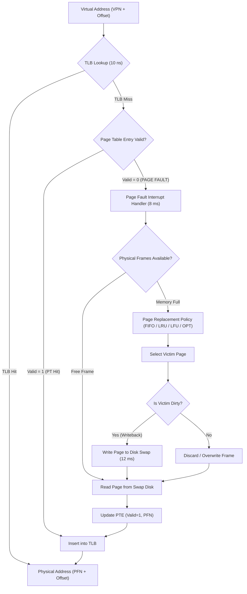

# Virtual Memory & Page Replacement Engine

[](https://isocpp.org/)
[](https://en.wikipedia.org/wiki/Virtual_memory)
[](LICENSE)
[]()

A high-performance, modular **Virtual Memory Simulator & Page Replacement Engine** written in modern C++. The engine models operating system memory management principles, demonstrating **demand paging, address translation (VPN to PFN), TLB caching, page fault handling, and dirty writebacks**.

It implements and benchmarks **FIFO, LRU, LFU, MFU, Optimal (OPT), and Clock (Second Chance)** replacement algorithms, and features an automated analyzer that visually proves and verifies **Bélády's Anomaly**.

---

## 🌟 Key Highlights & Engineering Features

- **Demand Paging & Page Fault Handling**: Accurately simulates the Memory Management Unit (MMU) interrupt pipeline, handling page faults, victim selection, and dirty-page disk writebacks.
- **Full Address Translation Pipeline**: Translates Virtual Address $(\text{VPN} + \text{Offset})$ to Physical Address $(\text{PFN} + \text{Offset})$ with simulated Translation Lookaside Buffer (TLB) caching.
- **$O(1)$ LRU & LFU Implementations**: Features custom-built **Doubly Linked Lists** and **Hash Maps** achieving strict $O(1)$ time complexity for page access, promotion, and eviction.
- **Bélády's Anomaly Verification & Visualizer**: Automatically analyzes execution traces across varying frame allocations (e.g. 2 to 7 frames) to graphically demonstrate and verify the occurrence of Bélády's anomaly in FIFO, while mathematically proving the Stack Inclusion Property for LRU and Optimal algorithms.
- **Multi-Workload Benchmarking Suite**: Evaluates algorithms across 4 diverse workloads (Locality of Reference 80/20, Cyclic/Streaming Loops, Uniform Random, and Bélády sequences), reporting Hit Ratios, Fault Ratios, Evictions, Dirty Writebacks, and **Effective Access Time (EAT)** in nanoseconds.
- **Interactive Dual Interface**: Features a rich ASCII terminal interface (with live memory frame state grids) and an interactive web dashboard (`web/index.html`).

---

## 🛠️ Tech Stack & Core Data Structures

- **Language**: Modern C++ (C++14)
- **Data Structures**:
  - `DoublyLinkedList<T>`: Handcrafted templated doubly linked list supporting $O(1)$ node detachment, prepend, append, and move-to-front operations.
  - `std::unordered_map`: Hash map for $O(1)$ lookup from Page Number to list node pointers.
  - `Frequency Buckets`: Hash map of doubly linked lists used by LFU to provide $O(1)$ frequency updates and deterministic LRU tie-breaking.
  - `Circular Frame Buffer`: Clock hand circular array for hardware-level Second Chance simulation.
- **OS Concepts**: Virtual Memory, Translation Lookaside Buffer (TLB), Page Table Entries (PTE), Page Fault Interrupts, Dirty & Referenced bits, Swap Space I/O, Effective Access Time (EAT).

---

## 🏛️ System Architecture



---

## 📊 Algorithmic Complexity

| Algorithm | Page Access Time | Eviction Time | Space Complexity | Description & Mechanism |
| :--- | :---: | :---: | :---: | :--- |
| **FIFO** | $O(1)$ | $O(1)$ | $O(F)$ | Evicts page that arrived earliest in physical memory. |
| **LRU** | **$O(1)$** | **$O(1)$** | $O(F)$ | Custom Doubly Linked List + Hash Map; evicts least recently accessed page. |
| **LFU** | **$O(1)$** | **$O(1)$** | $O(F)$ | Frequency buckets + Doubly Linked Lists; evicts least frequently referenced page with LRU tie-breaking. |
| **MFU** | $O(F)$ | $O(F)$ | $O(F)$ | Evicts page with highest frequency count based on the premise that newly loaded pages will be needed soon. |
| **Optimal (OPT)** | $O(1)$ | $O(N \cdot F)$ | $O(F)$ | Bélády's MIN; lookahead scan finding page with farthest future reference. Establishes the theoretical lower bound on page faults. |
| **Clock (Second Chance)** | $O(1)$ | $O(1)$ amortized | $O(F)$ | Circular buffer with reference bit; sweeps clock hand clearing bits until finding bit 0. |

*(Where $F$ = physical frame count, $N$ = length of reference string)*

---

## 🔬 Bélády's Anomaly: Analysis & Verification

In virtual memory systems, **Bélády's anomaly** is the counter-intuitive phenomenon wherein increasing the number of physical frames results in an **increase** in the total number of page faults for certain access strings under FIFO replacement.

### Empirical Verification

Using the canonical sequence: `1, 2, 3, 4, 1, 2, 5, 1, 2, 3, 4, 5`

```
Frames    FIFO Faults   LRU Faults    OPT Faults    Bélády Anomaly Indicator         
---------------------------------------------------------------------------------------
2         12            12            9                                                
3         9             10            7                                                
4         10            8             6             <-- * ANOMALY! (9 -> 10 faults) *  
5         5             5             5                                                
6         5             5             5                                                
```

```
--- ASCII Fault Distribution Chart (FIFO vs LRU) ---
Frames 2 | FIFO: [########################] (12 faults)
         | LRU : [========================] (12 faults)
Frames 3 | FIFO: [##################] (9 faults)
         | LRU : [====================] (10 faults)
Frames 4 | FIFO: [####################] (10 faults)  <-- FAULTS INCREASED!
         | LRU : [================] (8 faults)       <-- FAULTS DECREASED!
Frames 5 | FIFO: [##########] (5 faults)
         | LRU : [==========] (5 faults)
```

### Why Does It Happen?
- **FIFO is NOT a Stack Algorithm**: The set of pages held in $m$ frames under FIFO is **not necessarily a subset** of pages held in $m+1$ frames ($S_m \not\subseteq S_{m+1}$).
- **Stack Algorithms (LRU & Optimal)**: Maintain the *inclusion property* ($S_m(t) \subseteq S_{m+1}(t)$ for all time steps $t$). Therefore, increasing frame count is mathematically guaranteed to never increase page faults.

---

## 📈 Benchmark Results

Evaluated across standard workloads with **4 physical frames** (excerpt from exported `logs/benchmark_results.csv`):

### 1. Locality of Reference (80/20 Workload - 100 References)
Simulates realistic loops and functions where 80% of accesses reference 20% of hot pages:

| Algorithm | Hits | Faults | Hit % | Fault % | Evictions | Dirty Writebacks | Effective Access Time (EAT) |
| :--- | :---: | :---: | :---: | :---: | :---: | :---: | :---: |
| **Optimal (OPT)** | **84** | **16** | **84.0%** | **16.0%** | 12 | 4 | **1.76 ms** |
| **LFU** | 79 | 21 | 79.0% | 21.0% | 17 | 5 | 2.28 ms |
| **LRU** | 78 | 22 | 78.0% | 22.0% | 18 | 6 | 2.48 ms |
| **Clock** | 71 | 29 | 71.0% | 29.0% | 25 | 11 | 3.64 ms |
| **FIFO** | 69 | 31 | 69.0% | 31.0% | 27 | 12 | 3.92 ms |
| **MFU** | 66 | 34 | 66.0% | 34.0% | 30 | 17 | 4.76 ms |

### 2. Cyclic Loop / Thrashing (50 References)
Cyclic traversal over 5 pages with 4 physical frames ($N > F$):
- **FIFO, LRU, LFU, Clock, MFU**: Suffer **100% page fault rate** (0% hit rate) due to continuous cyclical eviction (classic memory thrashing).
- **Optimal (OPT)**: Intelligently anticipates future cycles, preserving a **68.0% hit rate** (16 faults).

---

## 📂 Project Structure

```
virtual_memory_engine/
│
├── include/                          # Header files
│   ├── MemoryTypes.hpp               # PTE, TLBEntry, MemoryReference, SimulationMetrics
│   ├── DoublyLinkedList.hpp          # Handcrafted templated O(1) Doubly Linked List
│   ├── PageReplacementAlgorithm.hpp  # Abstract base class for replacement policies
│   ├── FIFOReplacement.hpp           # First-In, First-Out policy
│   ├── LRUReplacement.hpp            # O(1) Least Recently Used policy
│   ├── LFUReplacement.hpp            # O(1) Least Frequently Used policy (frequency buckets)
│   ├── MFUReplacement.hpp            # Most Frequently Used policy
│   ├── OptimalReplacement.hpp        # Bélády's Optimal policy
│   ├── ClockReplacement.hpp          # Second Chance (Clock) policy
│   ├── PageTable.hpp                 # Virtual Memory Page Table simulation
│   ├── TLB.hpp                       # Translation Lookaside Buffer associative cache
│   ├── VirtualMemoryEngine.hpp       # MMU demand paging & address translation engine
│   ├── BeladyAnomalyDetector.hpp     # Anomaly detector & verification engine
│   ├── BenchmarkRunner.hpp           # Multi-workload benchmark coordinator
│   └── Visualizer.hpp                # Rich console tables & ASCII charts
│
├── src/                              # Implementation files
│   ├── FIFOReplacement.cpp
│   ├── LRUReplacement.cpp
│   ├── LFUReplacement.cpp
│   ├── MFUReplacement.cpp
│   ├── OptimalReplacement.cpp
│   ├── ClockReplacement.cpp
│   ├── PageTable.cpp
│   ├── TLB.cpp
│   ├── VirtualMemoryEngine.cpp
│   ├── BeladyAnomalyDetector.cpp
│   ├── BenchmarkRunner.cpp
│   ├── Visualizer.cpp
│   └── main.cpp                      # Interactive CLI & driver
│
├── web/                              # Interactive Web Dashboard
│   └── index.html                    # Zero-dependency browser visualizer
│
├── logs/                             # Benchmark exports
│   ├── benchmark_results.csv
│   └── benchmark_results.json
│
├── Makefile                          # Cross-platform build automation
├── build.ps1                         # PowerShell build script for Windows
├── run.ps1                           # PowerShell launch script
└── README.md                         # Project documentation
```

---

## 🚀 How to Build and Run

### Prerequisites
- Modern C++ Compiler supporting C++14: `g++`, `clang++`, or MSVC.

### Quick Start (Windows PowerShell)

```powershell
# 1. Build the engine
.\build.ps1

# 2. Launch the interactive menu
.\run.ps1
```

### Quick Start (Linux / MacOS / MinGW Makefile)

```bash
# Build
make

# Run Interactive Menu
./vmem_simulator.exe

# Or run specific modes via CLI flags:
./vmem_simulator.exe --test        # Run built-in unit tests
./vmem_simulator.exe --belady      # Run Bélády's anomaly visualizer
./vmem_simulator.exe --benchmark   # Run full benchmark suite & export CSV/JSON
./vmem_simulator.exe --vmem        # Run MMU demand paging address translation demo
./vmem_simulator.exe --demo        # Run full guided tour of all features
```

### Interactive Web Visualizer
Open `web/index.html` in any modern web browser to interact with live animated memory frames, step forward through reference streams, and explore the interactive Bélády anomaly chart.

---

## 📜 License

This project is open-source under the [MIT License](LICENSE).
